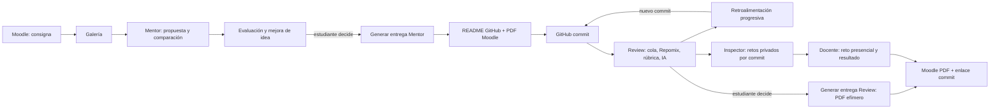

# Fragments — System Design MVP 1.0

## Propósito y límites
Fragments es una herramienta de evaluación formativa de proyectos, no un LMS ni un registrador de insumos. El docente administra tiempos/notas oficiales en Moodle por separado. Tres módulos: **Mentor** (propuesta viable, diferenciación, calificación formativa, README + PDF cuando estudiante decide), **Review** (análisis de commit y retroalimentación progresiva, entrega PDF) y **Inspector** (retos privados de modificación inversa y restauración, seleccionados y comprobados por docente). La galería académica F15 comparte automáticamente versiones Mentor evaluadas y con contexto versionado entre usuarios autenticados; las propuestas anónimas antiguas permanecen privadas hasta que el titular original las reclame. Sin aprobación docente obligatoria para generar entrega de Mentor. Evaluaciones repetidas permitidas, con controles de costo y rate limit, sin número rígido de entregas escolares.

## Flujos

## Arquitectura y estructura
Turborepo + pnpm workspaces; `apps/web` (React + Vite + TS), `apps/api` (Node + TS; router HTTP, worker en proceso separado con mismo código base); `packages/contracts` (esquemas Zod DTO y tipos inferidos), `packages/ui` SOLO si aporta reutilización real; `packages/config` opcional. SQLite WAL con cola en tabla y lease/heartbeat/idempotencia, sin Redis. VPS Oracle 2 vCPU/12 GB, Docker Compose local y producción con perfiles o archivos override. Reverse proxy Caddy o existente, TLS y volúmenes. AI SDK `ai` + Vercel AI Gateway (`AI_GATEWAY_API_KEY` solo servidor) con proveedor configurable por variable, sin modelo definitivo hasta benchmark. Driver `AiProvider` encapsula SDK. Driver `RepositoryReader` encapsula GitHub; `RepositoryPacker` usa Repomix fijado (procesos temporales con límites); `Clock`,`Hashing`,`PdfRenderer`,`QueueRepository` y `EvaluationStore` con interfaces delgadas, mocks en pruebas. No ejecutar código del estudiante en VPS en MVP.

### Slices verticales (en vez de crear capas completas sin valor)
S0 base funcional web/API/health/contratos. S1 propuesta Mentor end-to-end: pantalla→API→persistencia→fixture IA→resultado. S2 entrega Mentor README+PDF efímero+verificador. S3 Review por commit en cola, feedback y PDF. S4 Inspector privado por commit y registro docente. S5 galería opt-in e integración de calidad + hardening. Cada slice debe atravesar UI, API, persistencia, pruebas y evidencia.

## Endpoints mínimos propuestos (sujetos a contrato fijado por planner)
`GET /health`, `GET /api/gallery`, `POST /api/proposals`, `POST /api/proposals/:id/review`, `POST /api/mentor-submissions`, `GET /api/mentor-submissions/:id/readme`, `GET /api/mentor-submissions/:id/pdf`, `POST /api/reviews`, `GET /api/reviews/:id`, `POST /api/review-submissions`, `GET /api/review-submissions/:id/pdf`, `GET /api/verify/:code`, `GET /api/inspector/:reviewId/challenges`, `POST /api/inspector/:reviewId/challenges`, `POST /api/inspector/challenges/:id/assign`, `POST /api/inspector/challenges/:id/record`.
La ruta pública de verificación da solo microinforme no sensible. Todas las rutas Inspector requieren sesión docente en backend, no cachean sus respuestas y validan entrada/salida con `packages/contracts`; el hint docente nunca sale en la respuesta estudiantil.

## Invariantes de datos
- Propuesta editable = borrador; al pulsar Generar entrega se crea snapshot inmutable con campos necesarios para reconstruir README y PDF; no basta título+nota+hash.
- `sha256` del JSON canónico verifica integridad; token aleatorio de alta entropía sirve para lookup. Hash ≠ token secreto.
- PDF y README bajo demanda, no almacenados. Fecha/plantilla y versión de rúbrica fijadas en snapshot para reproducción semántica; PDF bytes no necesariamente idénticos si cambia renderer, registrar rendererVersion.
- Review ata rúbrica+versión+commit SHA+versión evaluador+input digest. Nuevo commit = nuevo análisis; igual commit/criterio = caché; reintentos solo en errores transitorios.
- Retos Inspector siempre vinculados a Review real y sus evidencias: precondición verificada, modificación inversa deliberada, pasos de demostración y restauración, ayudas privadas. Si nuevo commit: pendientes anteriores obsoletos; asignados a sesión quedan congelados; realizados conservados. No inventar archivos ni resultados de ejecución.
- Galería F15: sesión GitHub requerida, publicación automática solo tras evaluación persistida con contexto inmutable; no revelar puntajes, correos, nombres legales, retos ni repositorios privados. La retirada docente es auditada y conserva el historial.
- IA es orientativa; la decisión académica es docente.

## Modelo mínimo SQLite
`users(id,role,alias,...)`; `projects(id,owner_id,title,visibility,repo_url,...)`; `proposal_revisions(id,project_id,canonical_json,score,feedback,rubric_version,created_at)`; `submissions(id,kind,source_id,snapshot_json,score,sha256,verification_code,created_at)`; `evaluations(id,project_id,commit_sha,rubric_version,status,score,findings_json,model_id,created_at)`; `evaluation_jobs(id,evaluation_id,status,attempts,lease_until,updated_at)`; `challenges(id,evaluation_id,source_paths_json,prompt,teacher_help,expected_result,status)`; `defense_sessions(id,challenge_id,teacher_id,outcome,notes,created_at)`; `gallery_entries(id,project_id,approved_visibility,excerpt)`.
Campos exactos/migraciones los define W3. Índices por commit/rúbrica y verificación. No almacenar repositorios completos; limpiar temporales.

## Seguridad y fiabilidad
- Tratar README/código como datos no confiables (prompt injection); sanitizar entradas, longitud y rutas; GitHub URL allowlist y resolver repo mediante API oficial, no fetch arbitrario (SSRF).
- No ejecutar `npm install`, build o scripts de estudiantes en el VPS. Repomix en entorno limitado; nunca `--remote-trust-config`; excluir secretos, binarios, node_modules, lockfiles gigantes según tarea; no transmitir PII a IA.
- Limitar tamaño, tokens, concurrencia (1–2 al empezar), bytes, retries, timeout y presupuesto por cuenta. Encolar con transacción/lease; on restart se recuperan trabajos vencidos.
- Proteger auth docente y secretos; CORS, HTTPS, control de sesiones, audit log mínimo, backups SQLite (WAL coordinado), logs sin tokens.
- PDF verificado contra DB: token de verificación no acredita que el PDF no esté alterado visualmente; microinforme oficial es la fuente. No exponer detalles de retos.

## Diseño visual — fuente imagen de referencia
Tema **Pixel Garden Learning Lab**, original inspirado por la referencia aportada, no calcado. Crema `#FCF9F1`, tinta azul marino `#17345C`, azul `#6E9BCC`, azul cielo `#D8EAF9`, borde `#AFC4D9`, acento `#4776A9`. UI en español, jerarquía clara y moderna, pixel art como acento, no como obstáculo de lectura. Estilo 8/16-bit con contornos discretos; iconos SVG editables y hero original. Fuentes preferidas: títulos pixel legibles solo en display (fallback sans), cuerpo sans legible del sistema. Nada de texto de captura embebida. No copiar marca ni ilustración exactamente. `prefers-reduced-motion` obligatorio. Microanimación con `motion/react` al cambiar de estado de evaluación, hover/tap corto, galería y skeletons; nunca scroll pesado ni animaciones permanentes que distraigan.

## IA y Promptfoo
Tres prompts versionados (`mentor`, `review`, `inspector`) con salidas JSON esquema Zod. Tests en `evals/fixtures`: propuesta duplicada vs diferenciada, alcance sobredimensionado, código sin evidencias, archivo inexistente (debe rechazar), mutación inversa y restauración, prompt injection dentro de README. Promptfoo con asserts JSON estructurales/deterministas, opcional llm-rubric **solo** juez secundario con modelo explícito. Budget estricto en evals; fixtures offline de fallback; no afirmar pruebas si IA no las corrió.

## Pruebas UX
Ego(lite) + `ego-browser` como única herramienta de navegador para pruebas exploratorias, capturas y validación E2E en Windows del usuario. Verificar la conexión existente; si falla, registrar bloqueo sin sustituirlo por Playwright. Flujos mínimos: idea→nota→reintento→generar README/PDF; URL→cola→evaluación→feedback→PDF; docente→reto privado→registro; galería opt-in; vista móvil 390px, desktop 1440px; teclado, focus y reducción de movimiento.

## Criterios de aceptación transversales
Compilación, lint, types, pruebas unitarias, integración SQLite, E2E navegador, Promptfoo contra fixtures, review de accesibilidad, API health, Docker local/prod, ninguna clave cliente, faltas de evidencia documentadas. Nadie da tarea por cerrada sin `task-list/<id>/evidencie.md` con comando, resultado, enlace a captura/log, limitaciones.
